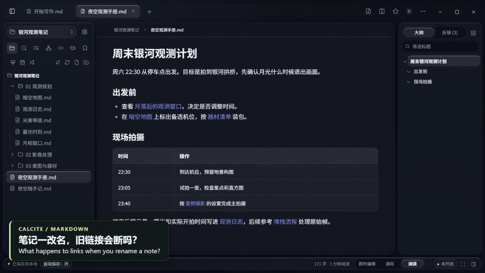

# Calcite

English · [简体中文](README_CN.md)

**Connect your notes. Keep them as Markdown files.**

 [](LICENSE) 

Calcite is a local-first Markdown workspace for Windows and Android. It’s for people who keep research, study notes, or project documentation in folders and want to link and read those notes across devices. No Calcite account or subscription is required.

[Quick start](#quick-start) · [Try the sample vault](#usage--examples)

<p align="center">
  
</p>

<p align="center">
  <a href="docs/media/demo.mp4">Watch the full 38-second demo (MP4)</a>
</p>

## Why Calcite

- **Keep the files you already have.** Open a Markdown folder on Windows and keep editing its files with other tools.
- **Reorganize a growing vault.** Rename or move notes and folders inside Calcite to update links throughout the vault.
- **Choose how your devices sync.** Pair over a trusted local network or use your own HTTPS Git repository.
- **Recover an overwritten draft.** If sync can’t merge competing edits, Calcite keeps the newer version and saves the other in version history.

## Core features

- **Find related notes.** Follow backlinks with context, preview linked notes, and explore the vault graph. Link to headings, use aliases, or embed another note. Find orphan notes, missing targets, and ambiguous links in the vault health panel.
- **Write, edit, and read in Markdown.** Switch between live editing, source, and reading views. Paste images into your vault, edit YAML properties, and render GFM tables and tasks, highlighted code, Mermaid diagrams, and KaTeX formulas. Start a daily note from a template.
- **Work with large folders.** The file tree loads without reading note bodies. Search, backlinks, and the graph reuse an incremental index keyed by path, modification time, and size.
- **Keep vaults separate and share what you need.** Open different folders on Windows or manage separate vaults in the Android app. Preview a Markdown file opened or shared from another Android app, then import it when you choose. Export PDF, PNG, standalone HTML, or a portable Markdown ZIP on both platforms. Windows also supports DOCX and EPUB export with Pandoc installed.

## Quick start

On Windows, install Node.js 22.12 or newer and Git. Run these commands in PowerShell. The initial setup downloads npm dependencies. Electron may download its runtime on the first launch.

```powershell
git clone https://github.com/dfzr8899/Calcite.git
cd Calcite
npm ci
npm run build
npm start
```

In Calcite, choose **Open Folder** (打开文件夹) and select `docs/demo-vault` from the checkout. Open `夜空观测手册.md` to try links, formulas, and tables before setting up sync.

For Android 7.0 and later, see the [APK build guide](MOBILE_BUILD.md#android-apk).

## Usage & examples

### Link to a specific section

In the [sample vault](docs/demo-vault/), add this line to `夜空观测手册.md`.

```markdown
Check the [[月相窗口#关联笔记|related observing notes]] before setting out.
```

In Reading view, click the label to open the `关联笔记` heading in `月相窗口.md`. Rename the target from Calcite’s file tree and the reference updates with it. Examples inside inline code or fenced code blocks stay intact.

### Read your Windows vault on Android

Connect both devices to the same trusted network or hotspot. On Windows, open **Settings → Sync & Pairing** (设置中心 → 同步与配对), choose local network sync, and display the pairing QR code. In Android’s vault manager, choose **Create by pairing** (配对新建), scan the QR code or paste the pairing string, then choose **Create and sync** (新建并同步).

<details>
<summary>Sync from different networks with your own Git repository</summary>

Create an empty private repository on GitHub or Gitee. In each device’s vault sync settings, choose remote Git and enter the HTTPS repository URL, branch, username, and token. For GitHub, scope a fine-grained token to the notes repository and grant **Contents: Read and write**. Test the connection and run a manual sync. [GitHub’s token setup guide](https://docs.github.com/en/authentication/keeping-your-account-and-data-secure/managing-your-personal-access-tokens)

```text
Repository: https://github.com/<username>/<notes-repo>.git
Branch:     main
Username:   <username>
```

When the remote and local files are unchanged, Calcite skips fetch and push. It tries a three-way merge for concurrent note edits and archives the older version when it can’t merge. Rules in `.gitignore` and `.gitattributes` merge line by line with duplicates removed.

</details>

## Architecture

The JavaScript frontend uses Vite, Milkdown, and CodeMirror. Electron hosts it on desktop, and Capacitor provides the Android bridge. The two apps share the Git engine and indexing logic.

| Directory | Role |
| --- | --- |
| [`shared/core/`](shared/core/) | Vault indexing, link rewriting, sync scheduling, Git merges and history |
| [`src/`](src/) and [`src/platform/`](src/platform/) | Editing and workspace UI, with platform adapters for storage, sync, and export |
| [`electron/`](electron/) and [`android/`](android/) | Desktop IPC, file watching, and LAN server. Android intents, printing, and credential storage. |
| [`tests/core/`](tests/core/) and [`scripts/`](scripts/) | Unit tests, smoke tests, license checks, and packaging |

## Roadmap

Feedback on sync recovery, Android file handling, and large-vault performance is welcome. When proposing a change, describe your platform, vault size, and workflow. [Suggest a feature](https://github.com/dfzr8899/Calcite/issues/new?template=feature_request.md)

## Contributing

Issues and pull requests are welcome in English or Chinese. Include reproduction steps, the affected platform, and the checks you ran. [Contribution guide](CONTRIBUTING.md) · [Security reports](SECURITY.md)

<details>
<summary>Local development checks</summary>

Run these from the project root after the quick-start build.

```sh
npm run typecheck
npm run test:unit
npm test
```

The full `npm run verify:all` runs the core type checks, unit and smoke tests, license checks, and production builds. See the contribution guide for browser and Android tooling prerequisites.

</details>

## License

Calcite is released under the [MIT License](LICENSE). Bundled components retain their own licenses. [Third-party notices](assets/THIRD-PARTY-NOTICES.txt)
