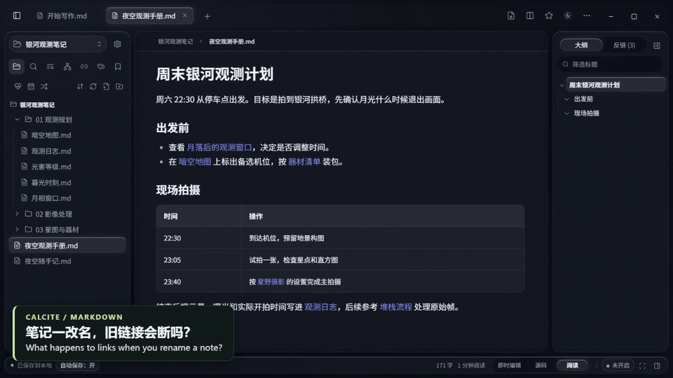

# Calcite

[English](README.md) · 简体中文

**用双链串起笔记，用 Markdown 留住原稿。**

 [](LICENSE) 

Calcite 是面向 Windows 和 Android 的本地优先 Markdown 知识库。适合把学习笔记、研究资料或项目文档存成文件，又希望跨设备读写、沿着双链查找资料的人。使用 Calcite 无需注册账号或订阅。

[快速开始](#快速开始) · [试用示例知识库](#使用示例)

<p align="center">
  
</p>

<p align="center">
  <a href="docs/media/demo.mp4">观看完整 38 秒演示（MP4）</a>
</p>

## 为什么用 Calcite

- **现有笔记可以接着用。** 在 Windows 打开已有的 Markdown 文件夹，原来的编辑器也可以继续读写这些文件。
- **资料多了也能放心整理。** 在 Calcite 里移动或重命名笔记和文件夹，库内的相关链接会一起更新。
- **同步方式自己选。** 在受信任的局域网配对，也可以接入自己的 HTTPS Git 仓库。
- **写过的稿子找得回。** 同步遇到无法合并的并发修改时，正文保留较新版本，另一份进入版本历史，可对比或恢复。

## 核心功能

- **顺着一条笔记找到相关资料。** 用带上下文的反链、链接预览和图谱找线索。可以链接到指定章节、为链接设置别名，或直接内嵌另一篇笔记。知识库体检会列出孤立笔记、悬空链接和有歧义的目标。
- **从记录到成稿都在 Markdown 里完成。** 可以切换即时编辑、源码和阅读视图，粘贴图片落盘，编辑 YAML 属性，渲染 GFM 表格与任务列表、代码高亮、Mermaid 图和 KaTeX 公式。写今日笔记时可以从模板开始。
- **大文件夹也能先打开再索引。** 文件树不预读笔记正文，搜索、反链和图谱共用按路径、修改时间和大小更新的增量索引。
- **分开管理知识库，按需导出。** Windows 按文件夹打开和切换知识库，Android 在应用内管理多个知识库。Android 从其他应用打开或接收分享的 Markdown 文件时可先预览，再决定是否入库。双端均支持 PDF、PNG 长图、独立 HTML 和 Markdown ZIP。Windows 安装 Pandoc 后还可导出 DOCX 或 EPUB。

## 快速开始

在 Windows 安装 Node.js 22.12 或更高版本及 Git，然后把下面的命令复制到 PowerShell。首次安装会下载 npm 依赖，首次启动也可能需要下载 Electron 运行时。

```powershell
git clone https://github.com/dfzr8899/Calcite.git
cd Calcite
npm ci
npm run build
npm start
```

启动后点击「打开文件夹」，选择刚克隆的仓库里的 `docs/demo-vault`，再打开 `夜空观测手册.md`。配置同步前就能直接试用双链、公式和表格。

Android 支持 7.0 及以上版本，构建安装包见 [APK 构建说明](MOBILE_BUILD.md#android-apk)。

## 使用示例

### 把链接指向笔记里的某一节

在[示例知识库](docs/demo-vault/)的 `夜空观测手册.md` 中加入下面一行。

```markdown
出发前，先看 [[月相窗口#关联笔记|相关观测记录]]。
```

切到阅读视图，点击「相关观测记录」，即可跳到 `月相窗口.md` 的「关联笔记」一节。在 Calcite 的文件树重命名目标笔记，原文中的引用也会随之更新。围栏代码块和行内代码中的示例保持原样。

### 在 Android 上接着读 Windows 的笔记

让电脑和手机连到同一个受信任的网络或热点。在 Windows 的「设置中心 → 同步与配对」中选择「局域网直连」，显示配对二维码。在 Android 的知识库管理中选择「配对新建」，拍摄扫描二维码或粘贴配对串，再点击「新建并同步」。

<details>
<summary>不在同一个网络时，用自己的 Git 仓库同步</summary>

在 GitHub 或 Gitee 上新建空白私有仓库。分别在两端的知识库同步设置中选择远程 Git，填写 HTTPS 仓库地址、分支、用户名和令牌。使用 GitHub 时，创建仅授权给笔记仓库的细粒度令牌，授予 **Contents: Read and write** 权限。测试连接后，执行一次手动同步。[GitHub 令牌配置说明](https://docs.github.com/en/authentication/keeping-your-account-and-data-secure/managing-your-personal-access-tokens)

```text
仓库地址：https://github.com/<username>/<notes-repo>.git
分支：main
用户名：<username>
```

远端分支和本地文件都没有变化时，跳过拉取和推送。两端同时编辑时会先尝试三方合并，合并不了的笔记旧版进入版本历史。`.gitignore` 和 `.gitattributes` 中的规则按行去重合并。

</details>

## 项目架构

前端使用 JavaScript、Vite、Milkdown 和 CodeMirror。桌面端由 Electron 承载，Android 通过 Capacitor 接入系统功能。Git 同步与索引逻辑由两端共用。

| 目录 | 职责 |
| --- | --- |
| [`shared/core/`](shared/core/) | 增量索引、改链、同步调度、Git 合并和版本历史 |
| [`src/`](src/) 与 [`src/platform/`](src/platform/) | 编辑器和工作区界面，存储、同步和导出按平台适配 |
| [`electron/`](electron/) 与 [`android/`](android/) | 桌面 IPC、文件监听和局域网服务，Android 文件打开、打印及凭据存储 |
| [`tests/core/`](tests/core/) 与 [`scripts/`](scripts/) | 核心单测、冒烟测试、许可证检查和打包 |

## 路线图

欢迎反馈同步恢复、Android 文件接收和大库使用体验。提出改进建议时，可以附上设备平台、库规模和具体使用场景。[提交功能建议](https://github.com/dfzr8899/Calcite/issues/new?template=feature_request.md)

## 参与贡献

欢迎用中文或英文提交 Issue 和 PR，并注明受影响的平台、复现步骤和已运行的检查。[贡献指南](CONTRIBUTING.md) · [安全问题报告](SECURITY.md)

<details>
<summary>本地开发检查</summary>

按快速开始完成构建后，在仓库根目录运行。

```sh
npm run typecheck
npm run test:unit
npm test
```

完整的 `npm run verify:all` 会执行核心类型检查、单测、冒烟测试、许可证检查和生产构建。浏览器与 Android 工具链的准备方式见贡献指南。

</details>

## 开源许可

Calcite 采用 [MIT License](LICENSE)。随应用分发的第三方组件适用各自的许可。[第三方声明](assets/THIRD-PARTY-NOTICES.txt)
