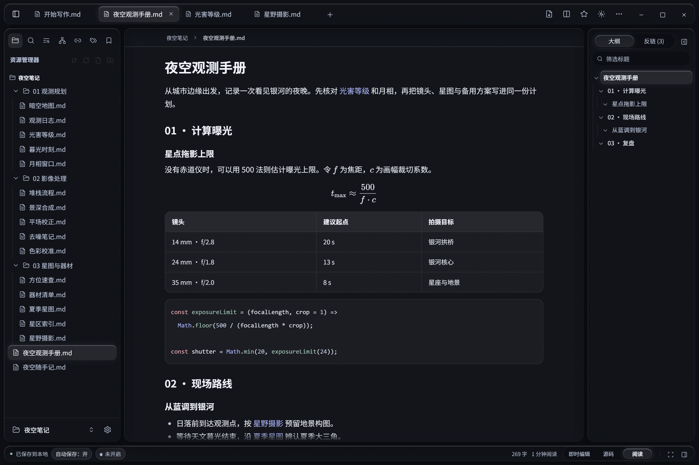
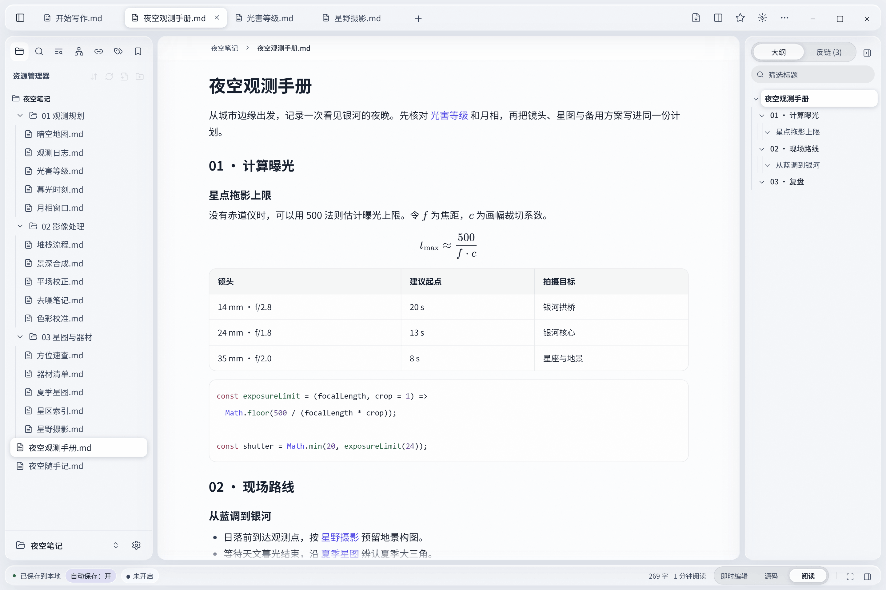
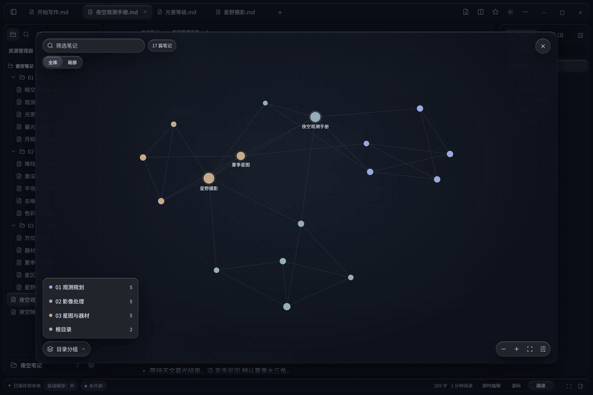
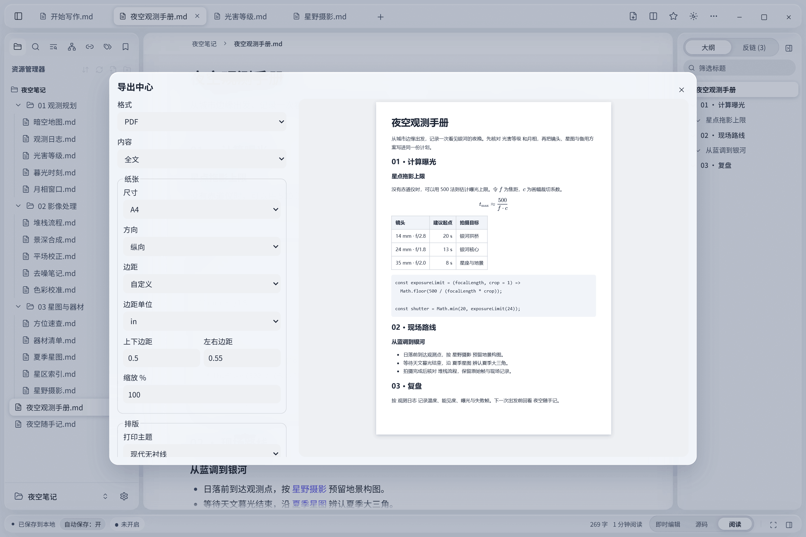
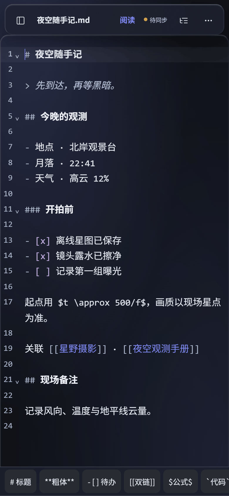

# Calcite

[中文](README.md) · English

**A local-first Markdown workspace.** Write in ordinary folders, connect notes with backlinks and a graph, and sync between your computer and phone when you need to.



| What it offers | What you get |
| --- | --- |
| Local Markdown files | A vault is a folder. Edit its notes in Calcite's live, source, or reading view, or open them in another editor. |
| Liquid Glass interface | Inspired by Apple's Liquid Glass, with dark and light themes, a solid appearance option, desktop materials, and touch-friendly drawers and Markdown shortcuts. |
| Two free Git sync modes | Pair on a local network or sync through your own private HTTPS Git repository. Calcite requires no account or subscription. |
| Desktop and mobile | A shared desktop interface for Windows, macOS, and Linux, with native storage and sharing on Android and iOS. |

## Preview

| Light desktop | Vault graph |
| --- | --- |
|  |  |

| Export Center | Mobile source editor |
| --- | --- |
|  |  |

The desktop captures use the same [sample vault](docs/demo-vault). Calcite renders GFM tables, task lists, KaTeX, highlighted code, and Mermaid diagrams. Navigate with the file tree, heading outline, backlinks, tags, and graph. Export standalone HTML, long images, rich text, and portable Markdown bundles. The desktop app also supports PDF and can use Pandoc for DOCX and EPUB.

## Choose a sync mode

| Mode | Best for | Getting started |
| --- | --- | --- |
| Local network | A shared Wi-Fi network, hotspot, or reachable private network | Open Sync & Pairing on the desktop and scan its QR code on your phone, or paste the pairing string. |
| Bring your own Git repository | Devices on different networks | Enter an HTTPS repository, branch, and access token, or import the settings from a one-time desktop QR code that expires after 60 seconds. Your Git host sets any storage limits or fees. |

Direct LAN sync uses plaintext HTTP. Use it only on trusted home Wi-Fi, a personal hotspot, or an encrypted Tailscale network. On public or campus networks, prefer your own remote Git repository over HTTPS.

Edits are saved locally first. With Git sync enabled, Calcite can keep local commits while offline and sync when the connection returns. Conflicting edits are kept in separate copies for comparison. Credentials use Electron safeStorage, Android Keystore, or iOS Keychain, with a session-only fallback when system storage is unavailable.

## Install and build

See this repository's Releases page for available `1.0.0` downloads. Windows x64 uses `Calcite-Setup.exe`, Android uses `Calcite-Android.apk` or `Calcite-Android-debug.apk`, macOS uses DMG or ZIP, and Linux uses AppImage. Build and sign the iOS project with Xcode.

Running from source requires Node.js 22.12 or newer.

```sh
npm ci
npm run build
npm start
```

| Platform | Local build |
| --- | --- |
| Windows x64 | `npm run package -- --installer-only` |
| macOS | `npm run package -- --platform=mac` |
| Linux | `npm run package -- --platform=linux` |
| Android 7+ and iOS 15+ | Run `npm run mobile:sync`, then use Android SDK 36 with JDK 21 or open the iOS project in Xcode. |

See the [mobile build guide](MOBILE_BUILD.md), [contribution guide](CONTRIBUTING.md), [changelog](CHANGELOG.md), and [release workflow](.github/workflows/ci-release.yml).

## License

Calcite source uses the [MIT license](LICENSE). Bundled dependencies and assets retain their respective licenses. See [third-party notices](assets/THIRD-PARTY-NOTICES.txt). Public redistribution of an installer containing Electron also requires reviewing the included Chromium and FFmpeg source and license obligations. [Electron runtime dependencies](https://github.com/electron/electron/blob/v45.4.1/DEPS) · [FFmpeg redistributor guidance](https://ffmpeg.org/legal.html)
