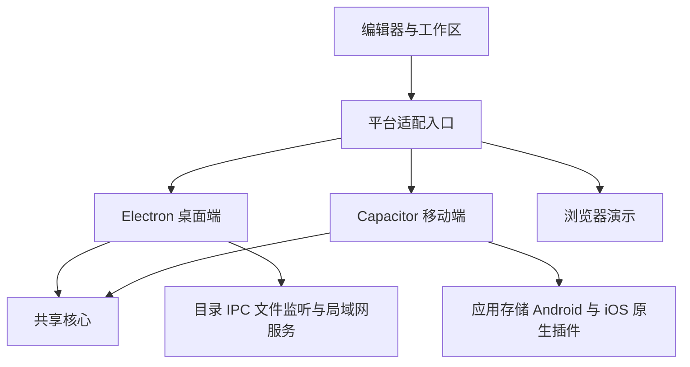

# Calcite 1.1.0 重构后项目分析报告

2026 年 11 月 24 日 · 分析范围为 `H:\Calcite` 的当前工作区，包含未提交和未跟踪的源码。使用本地 `HEAD`（`97296c6`）比对重构前后的实现。

Calcite 是本地优先的 Markdown 知识库。笔记和附件保存在用户选定或应用管理的 Vault，双链、反链、全文检索和图谱基于这些文件构建。1.1.0 延续了共享核心与平台适配的结构，主要补强外部编辑保护、移动与重命名撤销、同步恢复和中英文本地化。发布前建议优先处理两个已复现的问题。画布引用在撤销重命名后可能失效，活动日志格式异常时可能在文件已移动后仍报告失败。 [项目清单](../package.json) · [共享核心](../shared/core/) · [活动记录](../shared/core/activity-log.mjs)

## 架构与平台边界

| 层级 | 职责与边界 |
| --- | --- |
| `src/` | `main.js` 统筹启动、打开文档、标签页、草稿和保存。Milkdown 提供即时编辑，CodeMirror 提供源码编辑，阅读渲染使用 Marked 和 DOMPurify，公式和图表接入 KaTeX、Mermaid。设置、图谱、画布、移动外壳和导出界面各有模块。 [前端入口](../src/main.js) · [阅读渲染](../src/note-render.js) |
| `src/platform/` | 根据宿主选择 Electron、Capacitor 或浏览器适配器，向上提供 `fs`、`workspace`、`index`、`sync`、`export` 等接口。浏览器端提供演示能力，本地文件和同步操作要求原生宿主。 [适配入口](../src/platform/index.js) · [浏览器适配器](../src/platform/browser-adapter.js) |
| `shared/core/` | 索引、路径解析、批量改链、保存比对、事务日志、Git 合并、对象交换和同步调度。通过宿主传入 I/O 与路径实现，架构单测检查核心依赖是否引入宿主模块或 DOM。 [架构单测](../tests/core/architecture.test.mjs) · [Git 引擎](../shared/core/git-engine.mjs) |
| `electron/` | 主进程负责 Vault 授权、IPC 参数校验、事件发布、文件监听和导出。Preload 按白名单暴露接口，渲染器启用上下文隔离和沙箱。桌面端可监听外部文件变更并充当 LAN 同步服务端。 [主进程](../electron/main.cjs) · [Preload](../electron/preload.cjs) · [IPC 参数校验](../electron/ipc-schema.cjs) |
| `android/`、`ios/` | Android 原生插件负责接收外部 Markdown、原子文件操作、打印、安全存储和系统栏。iOS 已接入剪贴板、Keychain、原子文件操作与文档捕获。Android 最低 API 24，iOS 项目最低 15.0。 [Android 插件入口](../android/app/src/main/java/io/calcite/notes/MainActivity.java) · [iOS 插件入口](../ios/App/App/SceneDelegate.swift) · [移动构建说明](../MOBILE_BUILD.md) |

桌面端直接打开文件夹，由 watcher 更新目录和索引。移动端维护应用内 Vault，在文件操作、同步写入或回到前台时更新状态。Android 的系统「打开方式」和分享入口会先预览外部 Markdown，再由用户选择是否导入。共用编辑和同步核心降低了行为分叉，原生文件系统、打印、分享和凭据存储仍需按平台验收。 [桌面 Vault 服务](../electron/vault-service.cjs) · [移动适配器](../src/platform/capacitor-adapter.js) · [外部文件预览](../src/mobile-external-preview.js)

桌面与移动端共用 PDF、PNG、HTML 和 Markdown 包的导出界面。桌面由 Electron 的独立窗口渲染，并可调用 Pandoc 转 DOCX 或 EPUB。移动端走原生打印、捕获或页面渲染，再交给系统分享。1.1.0 还引入共享中英文词表和跟随系统语言的选项，Electron 菜单与 Android 原生提示分别接入对应宿主。动态状态可传递消息键与参数，在展示时按当前语言解析。 [桌面导出](../electron/main.cjs#L489) · [移动导出](../src/platform/capacitor-export.js) · [共享词表入口](../shared/i18n/index.mjs) · [前端语言切换](../src/localization.js) · [Android 语言配置](../android/app/src/main/java/io/calcite/notes/CalciteLanguage.java)

## 核心数据流程

### 保存与版本恢复

打开文档时，宿主读取正文以及包含修改时间、字节数和 SHA-256 的快照。前端将快照随保存请求传回。`guardedSave` 检查磁盘版本，对变化返回冲突，随后由界面提供重载、保留草稿或覆盖等选择。写入走临时文件和原子替换，替换前再次检查磁盘快照。桌面用 Node 文件系统，移动端通过原生插件替换。应用内写任务有串行队列，外部编辑器可以独立写入，最后比对与替换之间仍存在并发窗口。 [共享保存逻辑](../shared/core/guarded-save.mjs) · [桌面文件快照](../electron/data-safety.cjs) · [桌面原子写入](../electron/workspace.cjs#L33) · [移动原子写入](../src/platform/capacitor-adapter.js#L314)

### 双链索引与文件整理

文件树先读取文件元数据，索引再解析笔记的标题、属性、任务和链接。搜索、反链、图谱和知识库体检使用共享索引。桌面对文件签名加入 inode、创建时间和状态变更时间，移动索引主要依据修改时间和大小，应用内保存也可直接提交索引变更。搜索通过版本游标增量更新 Worker，图谱通过独立 Worker 布局。缓存损坏时可重建。 [共享索引](../shared/core/vault-index.mjs) · [桌面监听](../electron/watcher.cjs) · [移动索引](../src/platform/capacitor-index.js) · [搜索 Worker 入口](../src/vault-search.js) · [图谱视图](../src/graph-view.js#L213)

移动或重命名时，改链计划根据变化前后的路径解析结果重写 Markdown 引用，覆盖带章节、别名和嵌入的链接，并保留代码中的示例。活动记录持久化操作和撤销所需的快照，处理中断时可继续或回退，损坏或无法继续的事务日志会尝试隔离。活动记录最多保留 50 条，重命名与移动的撤销快照受 20 份和 50 MiB 的保留限制。该上限针对撤销快照。 [改链计划](../shared/core/link-refactor.mjs) · [事务恢复](../shared/core/refactor-journal.mjs) · [活动与撤销](../shared/core/activity-log.mjs)

### Git 同步

共享调度器将本地快照与网络同步分开。离线时可保留本地修改，联网并满足策略后再交换。1.1.0 为远程 Git 自动同步新增了前台轮询，默认间隔为 3 分钟。远程 Git 使用 HTTPS 和自管仓库，局域网模式由桌面提供 Git 对象交换服务。局域网新增共同提交锚点，找不到锚点时回退到完整对象协商。对象按批次或二进制传输，写入时有哈希校验。 [同步调度](../shared/core/sync-scheduler.mjs) · [远程 Git](../shared/sync-remote.mjs) · [对象交换](../shared/core/sync-exchange.mjs)

默认冲突策略对文本先尝试三方合并，重叠编辑按时间选择保留版本并将另一份归档。旧的冲突副本模式仍有处理入口。跨设备交换使用 Git 提交和对象。被覆盖版本的同步快照、活动记录和工作区回收站分别保存在 Vault 的 `.calcite/` 子目录，桌面普通保存还可在 Electron `userData/backups` 中保留历史。迁移 Vault 或验证备份时，需要区分 Git 中的已提交内容与这几类本机恢复数据。 [Git 合并与应用](../shared/core/git-engine.mjs#L432) · [冲突配置](../shared/core/sync-config.mjs) · [同步历史](../shared/core/sync-history.mjs) · [桌面备份入口](../electron/main.cjs#L21)

## 优先问题与改进顺序

### 高优先级的画布引用撤销问题

在 Windows 临时 Vault 中创建 `Original.md`、指向它的 Markdown 双链和一个画布文件卡片。重命名为 `Renamed.md` 后两处引用都更新。通过活动记录撤销后，`Original.md` 和 `[[Original]]` 都恢复，画布仍保存 `Renamed.md`，文件卡片因此失效。Electron 和 Capacitor 都在 `activity().refactor()` 提交后单独调用 `updateCanvasLinks()`，撤销只回放事务纳入的内容。应用在这两步之间中断，或画布写入失败，也可能留下悬空引用。移动端结论来自相同调用顺序的源码检查。 [桌面改名与撤销](../electron/main.cjs#L645) · [移动改名](../src/platform/capacitor-adapter.js#L471) · [移动撤销](../src/platform/capacitor-adapter.js#L724)

把画布的前后字节和路径一起放入改链计划，由同一份事务日志提交、回滚和恢复。验收用例同时覆盖移动、重命名和撤销，并验证批量改链中断时画布与 Markdown 指向同一状态。画布自身的保存路径目前先比对版本、再单独写盘，也适合复用替换前检查。 [桌面画布保存](../electron/main.cjs#L777) · [移动画布保存](../src/platform/capacitor-adapter.js#L689)

### 高优先级的活动日志恢复问题

在临时 Vault 将活动日志设置为结构不符合预期的合法 JSON（`{}`），直接运行桌面活动记录服务。活动列表读取失败，随后重命名也报错，但文件已经移动到目标路径，事务日志仍处于已提交状态。`load()` 处理了 JSON 解析错误，`entries()` 却直接将解析结果交给数组操作，异常发生在事务提交后的活动记录更新阶段。建议读取时校验日志结构并隔离异常文件，保留恢复线索，并加入「磁盘状态与操作结果一致」的回归用例。 [活动日志读取与提交回调](../shared/core/activity-log.mjs#L20) · [事务提交顺序](../shared/core/refactor-journal.mjs#L147)

### 局域网兼容路径的保护边界

新协议协商支持 AES-256-GCM 和 HMAC，请求可校验时间戳与防重放信息。初次能力探测仍使用 Bearer 配对令牌，桌面发布的 LAN 地址使用 HTTP，移动端旧 WebView 也有兼容分支。因此，加密与 HMAC 的保护范围取决于协商结果，不宜把局域网同步描述为从初次连接起全程加密。近期可在界面标出协商状态，验证较旧客户端的兼容路径，再评估如何在能力探测阶段保护长期配对凭据。 [桌面 LAN 客户端与服务端](../electron/lan-sync.cjs#L239) · [移动能力协商](../src/platform/capacitor-git-http.js#L193) · [官方仓库构建说明](../MOBILE_BUILD.md#本地数据与网络)

### 平台契约与模块复杂度

当前 `src/main.js` 约 3,250 行，`electron/main.cjs` 约 900 行，`capacitor-adapter.js` 约 770 行。保存、外部变更、会话恢复和切换 Vault 的控制仍集中在这些入口。`typecheck` 直接覆盖 `shared/core`，适配器形状、IPC 对接和 UI 状态主要靠冒烟测试。后续适合先为读档、受保护保存、切库及恢复定义双端都能运行的契约用例，再按这些流程拆分模块。 [前端入口](../src/main.js) · [桌面入口](../electron/main.cjs) · [移动适配器](../src/platform/capacitor-adapter.js) · [类型检查配置](../tsconfig.check.json)

### 大库与移动冷启动基线

索引缓存、批处理和 Worker 已经减少重复解析及主线程工作。本机运行 1,000 篇合成笔记的桌面测试时，索引首次构建约 1.42 秒，修改单篇后的更新约 23 毫秒，热索引搜索的 UI 响应约 61 毫秒。当前构建的前端入口 JS 约 1.78 MB，gzip 后约 559 kB。移动索引将单篇笔记的全文检索阈值设为 `Infinity`。移动端可沿用同一规模的测试库，加入长笔记，记录真机冷启动、首次搜索及单篇修改后索引更新的耗时和峰值内存，据此决定优化顺序。 [Vite 配置](../vite.config.js) · [移动索引配置](../src/platform/capacitor-index.js) · [桌面 1,000 篇测试](../scripts/watcher-index-smoke.cjs)

## 构建与验收

| 检查 | 本次结果 |
| --- | --- |
| `npm run typecheck` | 通过。执行环境为 Node 24.14.1。 |
| `npm run test:unit` | 34/34 通过。受限环境的首次执行有一项局域网用例因本机回环连接返回 `EACCES` 失败，允许回环访问后完整重跑通过。 |
| `npm run build` | Vite 生产构建通过。 |
| `node scripts/check-licenses.cjs` | 通过，按锁定版本和依赖范围接受 129 项历史例外。 |
| Android JVM 单测 | 强制重跑 `:app:testDebugUnitTest` 后 6/6 通过，其中 5 项覆盖外部 Markdown 的接收处理。 |
| `node scripts/smoke-suite.cjs` | 17/17 通过。覆盖桌面编辑、导出、检索、同步、意外退出后的改链恢复和中英文切换。移动 UI 与原生桥接通过 Chromium 和 Capacitor Mock 验证。中英词表的 1,265 个键及参数匹配。 |
| 现有分发包 | `Calcite-Setup.exe` 的 Authenticode 状态为 `NotSigned`。`Calcite-Android.apk` 声明版本 1.1.0、版本号 2，APK 签名验证通过，签名人为 Android Debug 证书。现有包尚未与工作区重新构建比对，也未执行安装验收。 |
| 原生平台 | ADB 设备列表为空，未执行 Android 安装与真机同步。当前 Windows 环境未进行 iOS 的 Xcode 构建。 |

发布工作流包含 Windows、macOS、Linux 桌面包和 Android APK 的产物校验及 SHA-256，Android 打标签时要求签名密钥。桌面强制签名由构建开关控制，发布工作流没有显式启用该开关。iOS 工作流步骤执行 `cap sync ios`，归档和分发需要 Xcode。`CHANGELOG.md` 仍停在 1.0.0，1.1.0 发布说明宜记录画布撤销修复状态、同步兼容范围和真机验收结论。 [质量门禁](../.github/workflows/ci.yml) · [发布工作流](../.github/workflows/ci-release.yml) · [桌面打包脚本](../scripts/package.cjs) · [更新记录](../CHANGELOG.md)
